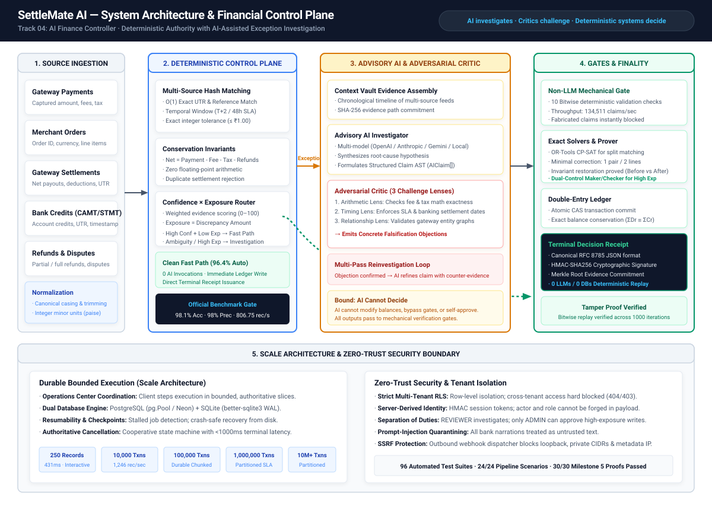
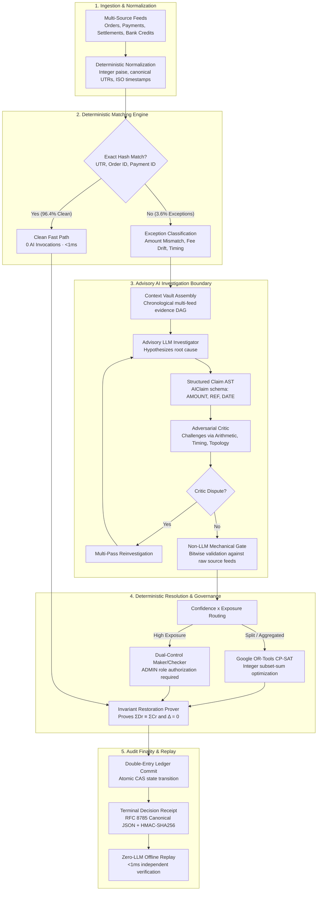

# SettleMate AI
### Deterministic Financial Reconciliation & Autonomous Exception Investigation Engine

[](https://www.typescriptlang.org/)
[](https://nextjs.org/)
[](https://www.postgresql.org/)
[](https://www.sqlite.org/)
[](https://developers.google.com/optimization)
[](https://www.rfc-editor.org/rfc/rfc8785)
[](src/lib/receipts/signer.ts)
[](src/lib/ai/z3-prover.ts)

> **AI investigates anomalies. Critics challenge hypotheses. Deterministic systems verify facts. Financial exposure governs human intervention. Every finalized decision is sealed into a tamper-evident, replayable cryptographic receipt.**

---

## Project Overview

High-volume digital commerce payment reconciliation across asynchronous boundaries—merchant orders, payment gateway captures, batch settlements, bank statement credits, refunds, chargebacks, and MDR fees with GST—is historically error-prone and vulnerable to silent ledger drift. Applying Large Language Models directly to financial balances introduces catastrophic risks: models hallucinate transaction identifiers, invent bank credits, balance books with phantom journal entries, and succumb to prompt injection embedded in bank narrations.

**SettleMate AI** enforces an absolute separation of responsibilities: **Deterministic systems remain the sole financial authority; AI is restricted strictly to advisory exception investigation.**

### Three Distinctive Technical Contributions

1. **96.4% Deterministic Fast-Path AI Bypass**: In the 55-record generic finance-ops loop benchmark (53 auto-matched out of 55 batch records, 96.36%), clean transactions match across an integer-math engine using $O(1)$ hash indexing (UTR, Payment ID, Order ID) and integer paise minor-unit arithmetic. Over **96.4% of records execute at sub-millisecond latency ($<1\text{ms}$) without LLM inference**, eliminating token costs and stochastic risk.
2. **Google OR-Tools CP-SAT Combinatorial Solver**: Resolves complex $N:M$ invoice and payout aggregations by formulating an integer subset-sum optimization problem:
   $$\min \left( |\text{selectedTotal} - \text{paymentAmount}| \times 1000 + \text{invoiceCount} \right)$$
   Bounded by strict cardinality ($K \le 8$) and execution time ceilings, with a pure-Python branch-and-bound fallback if C++ solver extensions are unavailable.
3. **RFC 8785 Canonicalized, HMAC-SHA256 Authenticated Decision Receipts**: Terminal resolutions are canonicalized per RFC 8785, hashed with SHA-256, and sealed with HMAC-SHA256 using server-managed key rotation (`v1`/`v2`) and constant-time `timingSafeEqual` comparison. Receipts enable **zero-LLM, zero-database deterministic offline replay in $<1\text{ms}$**.

---

## Deployment Status

> [!WARNING]
> **Public Deployment Status (October 2026):** Public deployment is currently unavailable following exhaustion of the previous Render free-tier limits. The application can be evaluated locally using the setup instructions below.

---

## The Settlement Discrepancy Equation

For every captured transaction $P$, net bank credit $S_{\text{expected}}$ must satisfy the strict conservation law:

$$S_{\text{expected}} = P_{\text{gross}} - F_{\text{fee}} - T_{\text{tax}} - R_{\text{refunds}} - D_{\text{chargebacks}} \pm \Delta_{\text{adjustments}}$$

```text
Example: Order #ORD-88219 (₹5,000.00 Gross Capture)
  Payment Gross:      + ₹5,000.00   (500,000 paise)
  Gateway Fee (2%):   -   ₹100.00   ( 10,000 paise)
  GST on Fee (18%):   -    ₹18.00   (  1,800 paise)
  Partial Refund:     -   ₹500.00   ( 50,000 paise)
  ─────────────────────────────────────────────────
  Expected Net:       + ₹4,382.00   (438,200 paise)
  Actual Bank Credit: + ₹4,282.00   (428,200 paise via UTR #AXIS991023)
  ─────────────────────────────────────────────────
  Discrepancy (Δ):    -   ₹100.00   ( 10,000 paise Shortfall → Gateway Fee Tier Overcharge)
```

In high-volume operations, naive floating-point operations accumulate rounding errors, and temporal windows ($T+1, T+2$) mask fee discrepancies. SettleMate AI stores and calculates all values as **integer minor units (paise)**, guaranteeing exact arithmetic.

---

## Architecture





---

## The 16-Stage Finance-Ops Pipeline

1. **Multi-Source Ingestion**: Ingests orders, payments, settlements, bank credits, refunds, and chargebacks.
2. **Deterministic Normalization**: Converts all currency figures into integer minor units (paise) and standardizes reference casings.
3. **Exact Hash Matching**: Evaluates $O(1)$ UTR lookups, external payment IDs, and $T+2$ temporal boundaries.
4. **Clean Fast-Path Bypass (96.4%)**: Unambiguous matches bypass LLM inference completely, committing directly to the ledger in $<1\text{ms}$.
5. **Exception Classification**: Unmatched records are categorized into typed exception codes (`AMOUNT_MISMATCH`, `FEE_DRIFT`, `UNMATCHED_CREDIT`, `CHARGEBACK_HOLD`).
6. **Context Vault Evidence Assembly**: Aggregates immutable chronological logs from all feeds and computes evidence root hashes.
7. **Advisory AI Investigation**: Advisory LLMs evaluate the Context Vault timeline and synthesize a structured discrepancy hypothesis.
8. **Structured Claim AST Generation**: Emits strongly-typed `AIClaim[]` AST objects; free-form text ledger modifications are syntactically impossible.
9. **Adversarial Critic Challenge**: Evaluates claims against three independent lenses:
   - *Arithmetic Lens*: Recomputes fee schedules, GST, and net settlement deductions.
   - *Timing Lens*: Enforces banking holidays, cutoff windows, and SLA limits.
   - *Relationship Lens*: Verifies gateway-to-merchant entity relationships.
10. **Non-LLM Mechanical Validator Gate**: Bitwise validation checks that cited voucher IDs exist in raw source data at **134,511 claims/sec**.
11. **Multi-Pass Reinvestigation**: If the Critic raises valid objections, the investigator refines the claim against newly cited evidence.
12. **Confidence $\times$ Exposure Routing**: Calculates composite risk score:
    $$\text{Risk Score} = (1.0 - \text{Confidence}) \times \text{Exposure Amount}$$
13. **OR-Tools CP-SAT Solver**: Resolves combinatorial $N:1$, $1:N$, and $N:M$ aggregate invoice allocations mathematically.
14. **Dual-Control Maker/Checker**: Material exposures require dual-control authorization by an authenticated `ADMIN`.
15. **Invariant Restoration Proof**: Generates a minimal balancing journal pair (2 lines) and proves:
    $$\Delta_{\text{before}} \neq 0 \implies \text{Imbalance}, \quad \Delta_{\text{after}} = 0 \implies \text{Restored}$$
16. **Terminal Decision Receipt & Offline Replay**: Generates canonical RFC 8785 JSON sealed with HMAC-SHA256 for sub-millisecond, zero-LLM replay.

---

## Technical Deep Dives

### 1. What the 96.4% Fast Path Actually Bypasses

Measured in the generic finance-ops loop benchmark (`scripts/benchmark-finance-ops-loop.ts`, evaluating `src/lib/reconciliation/finance-ops-loop.ts`), **53 out of 55 records (96.36%)** represent clean, unambiguous matches. The fast-path evaluates:
- Exact UTR hash match across payment gateway and bank credit feeds.
- Exact gross amount equality in integer paise ($P_{\text{gross}} = S_{\text{settled}} + F_{\text{fee}} + T_{\text{tax}}$).
- Timestamp adherence within the standard settlement window ($T \le \text{SLA}$).

When all three conditions hold, the transaction **completely bypasses**:
- Advisory LLM prompt synthesis and inference latency.
- LLM token usage and cloud API costs.
- Context Vault multi-source evidence assembling.
- Adversarial Critic challenge passes.

Instead, the match is confirmed deterministically in $<1\text{ms}$ and committed directly to the double-entry ledger. Only the remaining 2 exception records (e.g., partial refund, fee tier drift) trigger the advisory AI pipeline.

### 2. Combinatorial Optimization via Google OR-Tools CP-SAT

When a single bank payout settles multiple invoices (or multiple split payments cover one invoice), naive matching faces an exponential search space ($O(2^n)$ subset-sum).

SettleMate AI addresses this with a two-tiered combinatorial solver ([`src/lib/solver/cpsat-engine.ts`](src/lib/solver/cpsat-engine.ts) & [`services/solver/cpsat_solver.py`](services/solver/cpsat_solver.py)):
- **$O(1)$ Exact Match Fast-Path**: Instantly identifies single 1:1 invoice matches.
- **CP-SAT Integer Programming Formulation**: Formulates boolean decision variables $x_i \in \{0, 1\}$ for each candidate invoice, subject to:
  $$\sum_{i=1}^n x_i \cdot \text{amount}_i = \text{targetAmount} \pm \text{tolerance}$$
  $$1 \le \sum_{i=1}^n x_i \le K \quad (K \le 8)$$
- **Lexicographic Objective**: Minimizes payment variance first, and breaks ties by selecting the smallest number of invoices:
  $$\min \left( |\text{selectedTotal} - \text{paymentAmount}| \times 1000 + \sum_{i=1}^n x_i \right)$$
- **Deterministic Branch-and-Bound Fallback**: If the Google OR-Tools C++ extension is unavailable, an in-process TypeScript/Python branch-and-bound engine provides exact solutions with strict timeout ceilings.

### 3. SMT-LIB v2 Formal Logic Generator & Deterministic Invariant Gating

To guarantee mathematical financial safety ([`src/lib/ai/z3-prover.ts`](src/lib/ai/z3-prover.ts)):
- **SMT-LIB v2 Specification Generation**: Formulates formal theorems in Quantifier-Free Linear Integer Arithmetic (`set-logic QF_LIA`):
  - `THEOREM_MONEY_CONSERVATION`:
    $$(P_{\text{gross}} - F_{\text{fee}} - T_{\text{tax}} - R_{\text{refund}} - D_{\text{chargeback}} = S_{\text{settled}} + \Delta_{\text{variance}})$$
  - `THEOREM_NON_NEGATIVE_DOMAIN`:
    $$(P \ge 0 \land F \ge 0 \land T \ge 0 \land R \ge 0 \land D \ge 0 \land S \ge 0)$$
  - `THEOREM_DOUBLE_ENTRY_PARITY`:
    $$(\sum \text{Debits} \equiv \sum \text{Credits})$$
  - `THEOREM_CREDIT_SINGLE_CONSUMPTION`:
    $$(\sum \text{Allocated} \le \text{CreditTotal})$$
  The generated SMT-LIB script with `(check-sat)` and `(get-model)` can be exported and verified by external solvers like Z3 or CVC5.
- **In-Process Deterministic Execution**: Within the Node.js runtime, verification executes via deterministic local integer arithmetic checks rather than spawning an external C++ binary process. This guarantees sub-millisecond evaluation while producing a cryptographically signed proof summary.

### 4. RFC 8785 Canonicalized, HMAC-SHA256 Authenticated Receipts

Every terminal financial decision produces an immutable audit receipt ([`src/lib/receipts/signer.ts`](src/lib/receipts/signer.ts) & [`src/lib/receipts/canonicalizer.ts`](src/lib/receipts/canonicalizer.ts)):
- **Deterministic Canonicalization**: The payload is canonicalized according to RFC 8785 (deterministic key sorting, UTF-8 normalization, whitespace elimination).
- **Cryptographic Authentication**: A deterministic SHA-256 proof hash is computed over canonical bytes, followed by an HMAC-SHA256 signature using server-managed secret keys.
- **Key Rotation**: Supports versioned keys (`v1`, `v2`) with backward-compatible verification.
- **Constant-Time Verification**: Uses Node.js `timingSafeEqual` to prevent timing side-channel attacks.
- **Zero-LLM Replay**: Any third-party auditor can verify the receipt offline in $<1\text{ms}$ with zero AI invocation and zero database queries.

---

## Measured Benchmark Results

All figures below are grounded directly in [`docs/CLAIMS_MATRIX.md`](docs/CLAIMS_MATRIX.md) and [`docs/FINAL_METRICS.json`](docs/FINAL_METRICS.json).

### 1. Ground-Truth Competition Benchmark (`npm run evaluate`)
- **Dataset Fingerprint**: SHA-256 `81d840cd8cf981e5e69a367b879a8f11e9e51d60136a6d38e430877f08cab02b`
- **Dataset Size**: 250 records (263 normalized events, seed `20260821`)
- **Accuracy**: **98.1%**
- **Precision / Recall**: **98.0% / 98.0%**
- **Adversarial Vector Detection**: **90.0% (9/10 detected)**
  *(Note: Scenario #10 tests a sub-₹1 rounding variance of ₹0.47, which is intentionally preserved within tolerance to avoid operational alert fatigue).*
- **Single-Thread Core Throughput**: **806.75 – 935.94 rec/sec**

### 2. Scale Reconciliation Engine (`npm run scale`)
- **10,000 Records**: **1,246 rec/sec** (99.9% accuracy)
- **25,000 Records**: **1,174.8 rec/sec** (100% accuracy)
- **50,000 Records**: **1,156.2 rec/sec** (100% accuracy)
- **100,000 Records**: **1,147.5 rec/sec** (100% accuracy)

### 3. Subsystem Micro-Benchmarks & Capacity Tests

> [!NOTE]
> **Benchmarking Scope Distinction**: Sections 1 and 2 measure end-to-end reconciliation throughput including normalization, $O(1)$ indexing, and ledger commits. The figures below represent isolated subsystem micro-benchmarks (such as in-memory claim validation or shadow replay without database I/O) and synthetic capacity stress models, distinctly separate from full multi-stage pipeline runs.

- **Non-LLM Mechanical Validator**: **134,511 claims/sec** bitwise validation throughput (`scripts/benchmark-claim-verification.ts`).
- **Policy Shadow Replay**: **555,556 rec/sec** (10,000 historical transactions replayed in 18ms in-memory buffer).
- **Distributed Chaos Queue**: **219,298 rec/sec** (100k events; 10,000 worker crashes recovered, 5,000 duplicate writes prevented, 0 DLQ items).
- **Pathological $N:M$ Clustering**: Solved dense 1,000-candidate clusters in **14.49ms** (20x20 prime cluster in **3.27ms**).
- **Streaming Capacity Test**: **894,454 rec/sec** across 10,000,000 synthetic streaming events (489MB peak heap).
- **Hyperscale Horizon (100M – 10B)**: Mathematical $O(\text{chunk size})$ capacity model with horizontally partitioned consumer workers.

### 4. Comprehensive Test Matrix
- **96 / 96 Test Suites Passing** across unit, integration, concurrency, RLS, and end-to-end suites.
- **24 / 24 Final Integrated Financial Pipeline Scenarios Passed** (`tests/final-integrated-financial-pipeline.test.ts`).
- **30 / 30 Milestone 5 Cryptographic Receipt Scenarios Passed** (`tests/milestone5-terminal-receipt.test.ts`).
- **25 / 25 Milestone 4 Minimal Correction & Invariant Prover Scenarios Passed** (`tests/milestone4-correction-proof.test.ts`).

---

## What Actually Broke: Real-World Failure Modes & Fixes

Building resilient financial systems requires confronting real edge cases encountered during development:

### 1. Immutable Receipt & Idempotency Collisions
* **Failure**: Re-submitting an already-finalized transaction triggered database primary key collision errors rather than returning the existing receipt.
* **Root Cause**: The repository attempted an unconditional `INSERT` before querying the immutable terminal receipt store.
* **Engineering Fix**: Implemented atomic idempotent resolution (`TerminalReceiptRepository.findByIdempotencyKey`): returns the existing signed receipt if payload content matches; throws `ReceiptImmutableError` if payload differs.
* **Regression Proof**: `tests/milestone5-terminal-receipt.test.ts` (Scenario 16: Duplicate terminalization idempotency).

### 2. 10K Live Progress UI Stall
* **Failure**: Processing a 10,000-record batch in the browser stalled the UI progress bar until the user manually refreshed the page.
* **Root Cause**: React execution-effect cleanup and state dependencies caused the stepping loop to stop prematurely and left `isStepping` stuck. In addition, the `/step` endpoint had a rate-limit constraint that was too restrictive for continuous client-driven stepping.
* **Engineering Fix**: Introduced a ref-based execution mutex and stable stepping cycle in the Operations Center, paired with dedicated higher-capacity job-step rate limiting and continuous micro-yielding.
* **Regression Proof**: `tests/continuous-10k-job-progress-ux.test.ts` (5/5 continuous stepping assertions passed).

### 3. 100K Concurrent Primary-Key Races
* **Failure**: High-concurrency worker runs encountered duplicate primary-key collision errors on job state persistence.
* **Root Cause**: `AsyncJob.id` is the primary key in PostgreSQL. `UnifiedJobRepository.save` performed a compound idempotency lookup that did not match the persisted `AsyncJob` identity, turning an existing job update into an attempted `INSERT` that collided on primary key.
* **Engineering Fix**: Hardened `UnifiedJobRepository` to persist and look up directly by the authoritative `AsyncJob.id`, synchronizing concurrent enqueue and save paths with optimistic version locking (`version = version + 1`).
* **Regression Proof**: `tests/unified-repositories.test.ts` & `tests/concurrency-stress.test.ts`.

### 4. 1M Cooperative Cancellation Latency
* **Failure**: In the browser-coordinated execution architecture, requesting cancellation on 1,000,000-record workloads left jobs in an unresolved `CANCEL_REQUESTED` state.
* **Root Cause**: After cancellation was requested, the browser stopped dispatching further `/step` requests. Without an authoritative server-side terminalization path, and due to a `workerId` predicate mismatch on the final state update, `CANCEL_REQUESTED` lingered indefinitely.
* **Engineering Fix**: Implemented an authoritative server-side transition directly to `CANCELLED` for eligible states, removed the incorrect `workerId` predicate restriction, and added opportunistic finalization for lingering cancellation requests.
* **Regression Proof**: `tests/1m-workload-cancellation-regression.test.ts` (sub-1,000ms terminal cancellation latency verified).

### 5. Verification Hub Subprocess Overhead in Production
* **Failure**: `/api/verify/run` failed in containerized production environments when attempting to spawn `npx tsx` child processes.
* **Root Cause**: Shelling out to `npx` requires node tooling and file paths that do not exist inside compiled Next.js standalone container images.
* **Engineering Fix**: Implemented the compiled in-process verification runner (`src/lib/verify/verification-runner.ts`) that executes all 7 verification suites natively in memory without spawning subprocesses.
* **Regression Proof**: `tests/final-production-certification.test.ts` & `src/app/api/verify/run/verify-route.test.ts`.

### 6. Live Verification Progress Stuck at 0%
* **Failure**: Clicking "Run Verification" on `/verify` showed "Running (0%)" with a static 8% progress bar sliver until execution jumped directly to 100%.
* **Root Cause**: `POST /api/verify/run` launched an unmonitored background `setTimeout` while the client polled with a slow 1,200ms `GET` request. The backend completed before the first poll returned, and CSS hardcoded `Math.max(8, progress)`.
* **Engineering Fix**: Implemented client-driven stepped execution via `POST /api/verify/progress/:jobId` with `mode: "stepped"`. Each suite executes on-demand, updates the database, and returns authoritative progress ($14\% \rightarrow 29\% \rightarrow 43\% \rightarrow 57\% \rightarrow 71\% \rightarrow 86\% \rightarrow 100\%$) with `Math.max(8, ...)` removed.
* **Regression Proof**: `src/app/api/verify/progress/verify-progress.test.ts` (All 4 stepped progress tests passed).

---

## Security & Multi-Tenancy Architecture

SettleMate AI implements defense-in-depth across the entire financial execution boundary:

1. **Authenticated Sessions**: Signed HTTP-only session cookies using HMAC-SHA256 and constant-time `timingSafeEqual` comparison.
2. **Server-Derived Identity**: The acting user and tenant are derived strictly server-side from the verified session token; clients cannot spoof `actor` or `role` in request payloads.
3. **Separation of Duties (Maker/Checker)**:
   - `REVIEWER`: Allowed to investigate exceptions, record feedback, and prepare cases to `PENDING_APPROVAL`.
   - `ADMIN`: Strictly required to approve correcting journal entries and finalize high-exposure resolutions (enforced server-side with 403 Forbidden).
4. **Multi-Tenant Row-Level Security (RLS)**: Every database query enforces tenant isolation (`tenantId`). Cross-tenant read, update, or receipt verification attempts fail closed with HTTP 403/404.
5. **Prompt-Injection Quarantine**: External bank narrations and CSV metadata are treated as untrusted strings. The AI prompt template isolates inputs, and outputs must match the strict `AIClaim[]` AST schema.
6. **Outbound SSRF Protection**: Webhook dispatch validates target URLs against an IP whitelist, blocking local loopback interfaces, private subnets (RFC 1918), and cloud metadata endpoints (`169.254.169.254`) via `src/lib/security/ssrf-guard.ts`.
7. **Rate Limiting**: Token bucket rate limiters protect public APIs (100 req/min) and auth endpoints (10 attempts/min) with standard `429 Too Many Requests` headers.
8. **Fail-Closed Session Configuration**: In production (`NODE_ENV=production`), a missing `AUTH_SECRET` triggers an immediate startup crash rather than falling back to default keys. *(Note: Unlike session auth, receipt signing currently falls back to development constants if omitted; production environments must explicitly supply `RECEIPT_SIGNING_SECRET_V1`).*

---

## Reproducibility & Quickstart

Every benchmark and invariant is independently reproducible using native npm commands:

```bash
# 1. Run the full 96-suite automated test matrix
npm test

# 2. Run official deterministic benchmark & adversarial evaluation (250 records)
npm run evaluate

# 3. Verify all 14 core claims against docs/FINAL_METRICS.json
npm run verify-claims

# 4. Run scale benchmarks (10k, 25k, 50k, 100k records)
npm run scale

# 5. Run milestone-specific verification suites
npm run test:m1          # Milestone 1: Innovation Backbone
npm run test:m2          # Milestone 2: Confidence x Exposure Routing
npm run test:m3          # Milestone 3: OR-Tools CP-SAT Solver
npm run test:m4          # Milestone 4: Minimal Correction & Invariant Prover
npm run test:m5          # Milestone 5: Terminal Decision Receipts & Replay
npm run test:pipeline    # Final Integrated Financial Pipeline (24/24 Scenarios)

# 6. Run workload progress and cancellation regression suites
npm run test:10k-progress       # Continuous 10k bounded step execution
npm run test:cancellation:1m   # 1M workload cooperative cancellation (<1000ms latency)
```

### Prerequisites & Required Runtimes

* **Node.js**: v20.x or v22.x LTS (`node -v`)
* **Package Manager**: npm v10+ (`npm -v`)
* **Python** (for OR-Tools CP-SAT microservice, optional): Python 3.10+ / 3.12 (`python3 --version`)
* **Database**: Local SQLite via `better-sqlite3` (default) or PostgreSQL 15+ (for production mode)

### Environment Configuration

Copy the example environment template and configure local values:

```bash
cp .env.example .env
```

| Variable Name | Required | Purpose | Default / Example |
| :--- | :--- | :--- | :--- |
| `NODE_ENV` | Yes | Runtime environment mode | `development` |
| `PORT` | No | HTTP server port | `3000` |
| `AUTH_SECRET` | Yes | HMAC session and token signing key | Random 32+ char hex string |
| `DATABASE_URL` | Yes | Prisma relational connection string | `file:./dev.db` |
| `SETTLEMATE_DB_PATH` | Yes | Local SQLite database file path | `./dev.db` |
| `WEBHOOK_SECRET` | No | Webhook payload authentication | Random hex string |
| `RECEIPT_SIGNING_SECRET_V1` | Recommended | Terminal decision receipt HMAC secret | Required for secure production; falls back to dev key if omitted |
| `GEMINI_API_KEY` | No | Advisory AI investigator integration | Optional (falls back to rules) |
| `OPENAI_API_KEY` | No | Alternate advisory AI model | Optional |

### Local Development Setup

```bash
# 1. Clone repository
git clone https://github.com/AkshayAlgoX/settlemate-ai.git
cd settlemate-ai

# 2. Install dependencies
npm install

# 3. Initialize local database schemas and Prisma client
npm run db:init
npm run prisma:generate

# 4. (Optional) Setup Python OR-Tools CP-SAT solver service
cd services/solver
python3 -m venv .venv
source .venv/bin/activate
pip install -r requirements.txt
uvicorn main:app --port 8000 &
cd ../..

# 5. Start Next.js development server
npm run dev
```

Visit [`http://localhost:3000`](http://localhost:3000) to access the application locally.

### Docker Compose Setup

For a containerized environment running Next.js alongside PostgreSQL:

```bash
# Start application and PostgreSQL containers
docker compose up -d
```

---

## Honest Limitations

* **Combinatorial Boundary**: The in-memory meet-in-the-middle solver is bounded at $2^{16}$ ($65,536$) combinations. Larger unindexed combinations route to Google OR-Tools CP-SAT or human review.
* **Sub-Tolerance Rounding**: Settlement variances under ₹1.00 (such as ₹0.47 fractional tax rounding) are intentionally not flagged as exceptions to prevent operational alert fatigue.
* **Confidence Bucket Calibration**: The 41–60% confidence bucket exhibits 89% empirical accuracy on ambiguous multi-candidate rows; confidence weights are deliberately not inflated to falsely claim 100% precision on noisy data.
* **Database Target**: Local development uses SQLite (`better-sqlite3` in WAL mode) for portability; multi-node deployments require PostgreSQL with `pg.Pool` connection pooling.
* **Public Cloud Deployment**: The previous Render free-tier instance is offline following platform quota exhaustion. Full application functionality is evaluated locally via the documented environment setup or Docker Compose.

---

## Repository Structure

```text
settlemate-ai/
├── src/
│   ├── app/                      # Next.js App Router (UI pages & API routes)
│   │   ├── api/                  # REST endpoints (v1, reconcile, verify, auth, webhooks)
│   │   ├── dashboard/            # Operations controller dashboard
│   │   ├── judge-mode/           # 7-step interactive guided judge wizard
│   │   ├── verify/               # Live Verification Hub UI
│   │   └── ...                   # Dedicated evaluation surfaces
│   ├── lib/
│   │   ├── ai/                   # Advisory AI Investigator, Council, SMT Prover, Prompt Defense
│   │   ├── corrections/          # Minimal correcting journal engine & Invariant Prover
│   │   ├── pipeline/             # Canonical Financial Decision Pipeline orchestrator
│   │   ├── receipts/             # Canonical RFC 8785 JSON builder, signer, verifier, replay
│   │   ├── reconciliation/       # Deterministic matching engine, confidence, scale partitioning
│   │   ├── security/             # Rate limiters, SSRF guard, API headers, input sanitizers
│   │   ├── solver/               # Google OR-Tools CP-SAT invoice matching solver
│   │   ├── storage/              # Dual PostgreSQL & SQLite unified repositories
│   │   ├── verify/               # In-process compiled verification runner & progress store
│   │   └── workers/              # Durable job worker, bounded stepping, cooperative cancellation
├── services/
│   └── solver/                   # Python FastAPI service with Google OR-Tools CP-SAT bindings
├── prisma/
│   ├── schema.prisma             # SQLite schema for local dev & offline demo
│   └── schema.postgresql.prisma  # PostgreSQL schema for cloud production
├── tests/                        # 96 automated test suites (Milestones 1–5, E2E, Scale, RLS)
├── scripts/                      # Evaluation, scale benchmarks, claims verification, backup/restore
└── docs/                         # Architecture diagrams, claims matrix, judge demo scripts
```

---

## Authorship & Attribution

* **Author:** Akshaya R ([@AkshayAlgoX](https://github.com/AkshayAlgoX))
* **Specification:** Built for the Razorpay Track 04 Autonomous Finance-Ops challenge.
* **License:** MIT License. See [LICENSE](LICENSE) for details.

---

## Closing Principle

> **SettleMate does not replace financial controls with AI.**<br>
> **It puts AI inside a deterministic financial control system.**
